# EventMitra – Event Planning Platform

EventMitra is a web-based event planning platform designed to make organizing events easier and more convenient.

It brings multiple event-related services together in one place, helping users explore services and manage their event requirements.

## Features

- **Event Selection:** Explore different event types such as weddings, birthdays, and corporate events.
- **Multiple Services:** Find services like decoration, catering, DJ, and venue arrangements.
- **Service Management:** Admin-side service management.
- **Inquiry Management:** Manage customer inquiries and booking-related requests.
- **Easy Coordination:** Aims to simplify communication between customers and service providers.

## Technologies Used

| Frontend | Backend | Database |
|---|---|---|
| React.js | Node.js | MongoDB |
| HTML | Express.js | |
| CSS | JavaScript | |

## Project Structure

```text
EventMitra/
├── frontend/
├── backend/
├── Screenshots/
├── .gitignore
└── README.md
```

## Screenshots

### 1. Home Page
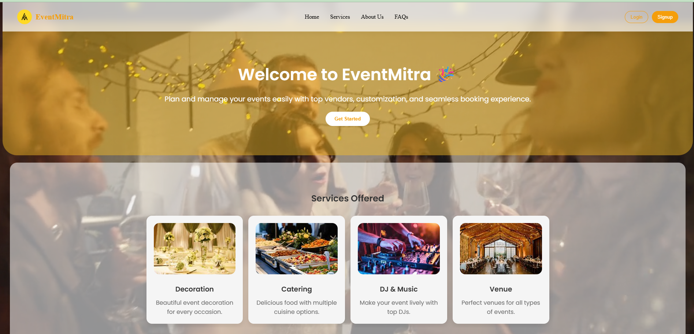

[View Full Screenshot](Screenshots/home.png)

### 2. About Us
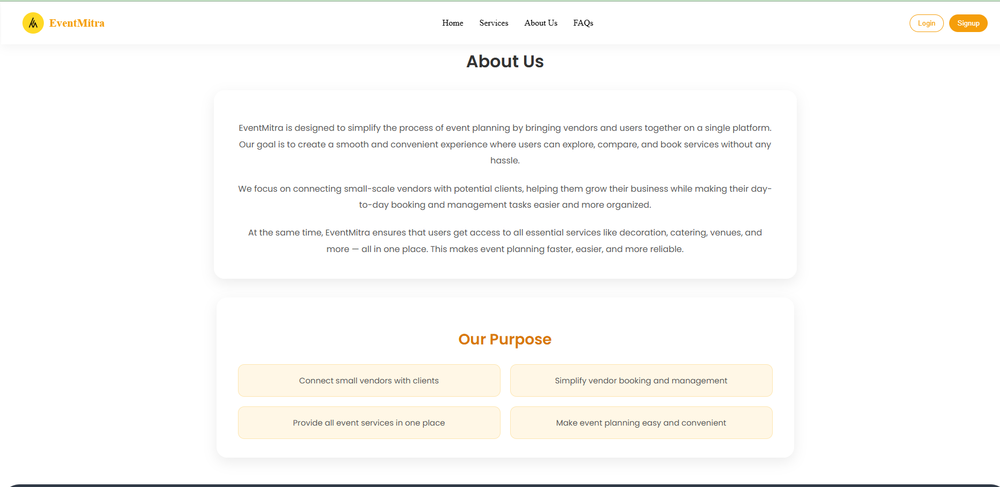

[View Full Screenshot](Screenshots/about.png)

### 3. Signup
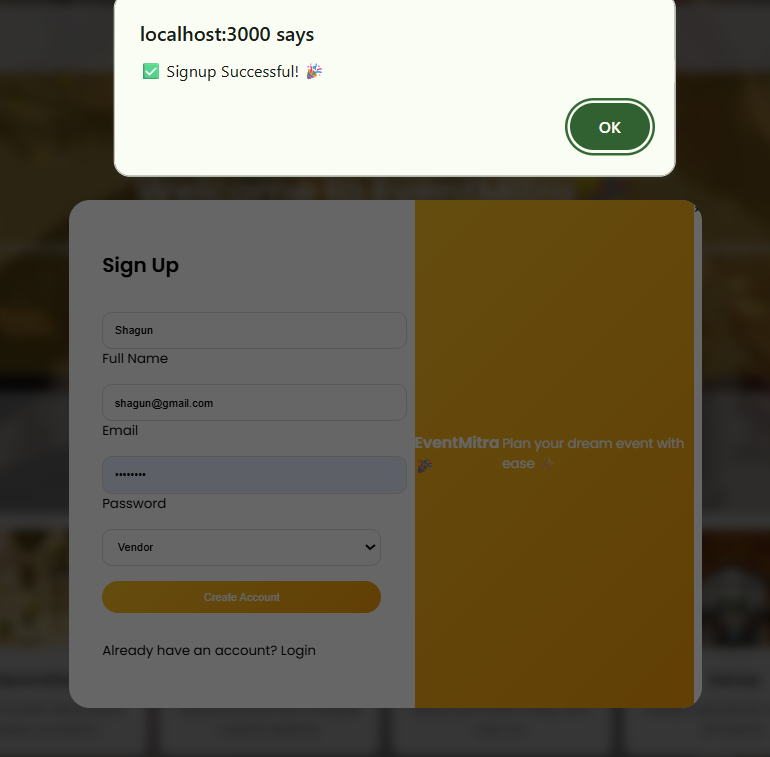

[View Full Screenshot](Screenshots/signup.png)

### 4. Login
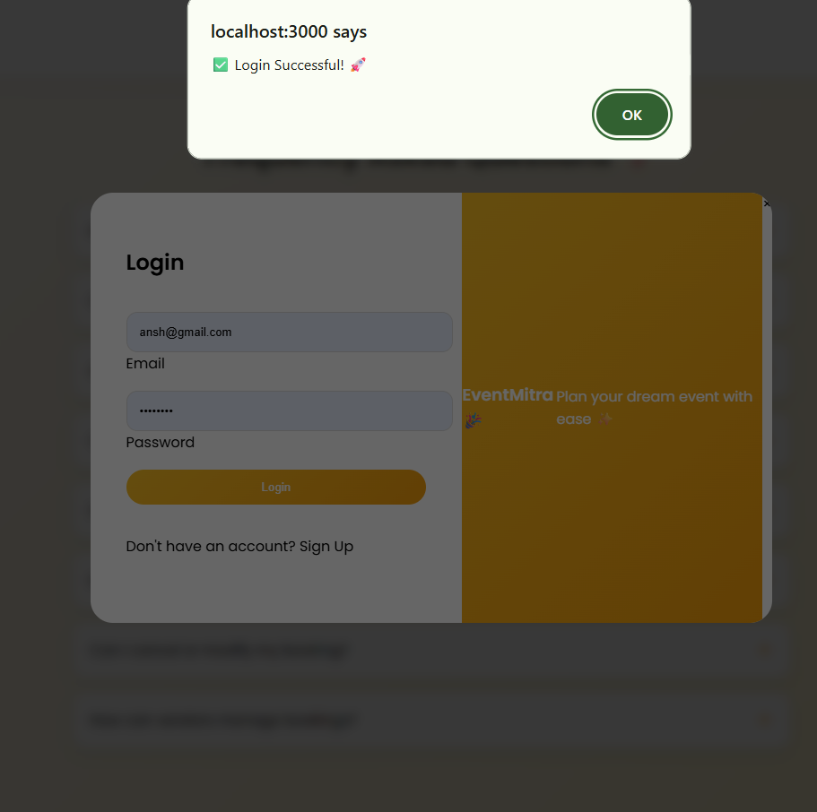

[View Full Screenshot](Screenshots/login.png)

### 5. Services
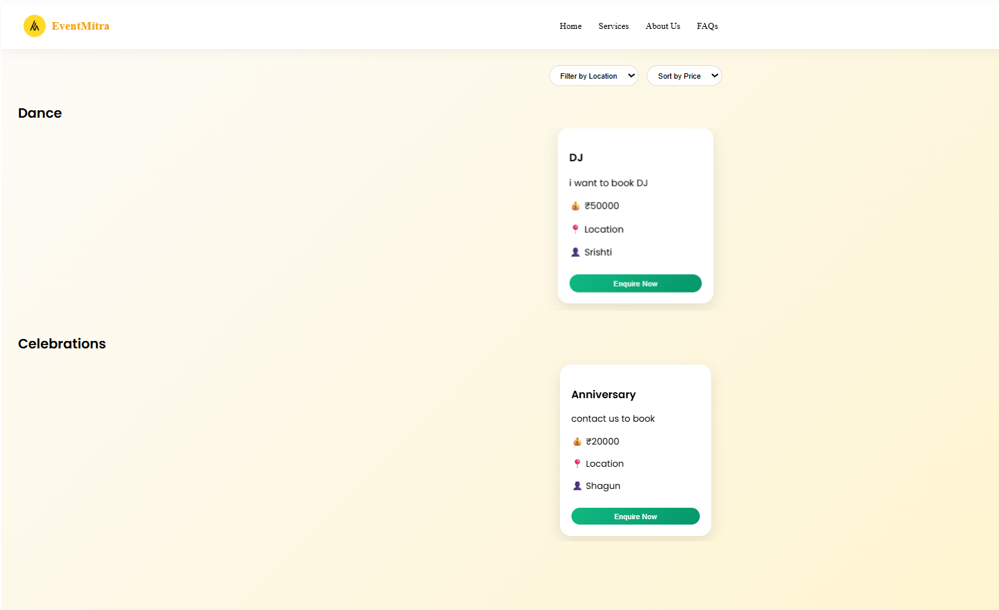

[View Full Screenshot](Screenshots/services.png)

### 6. Vendors
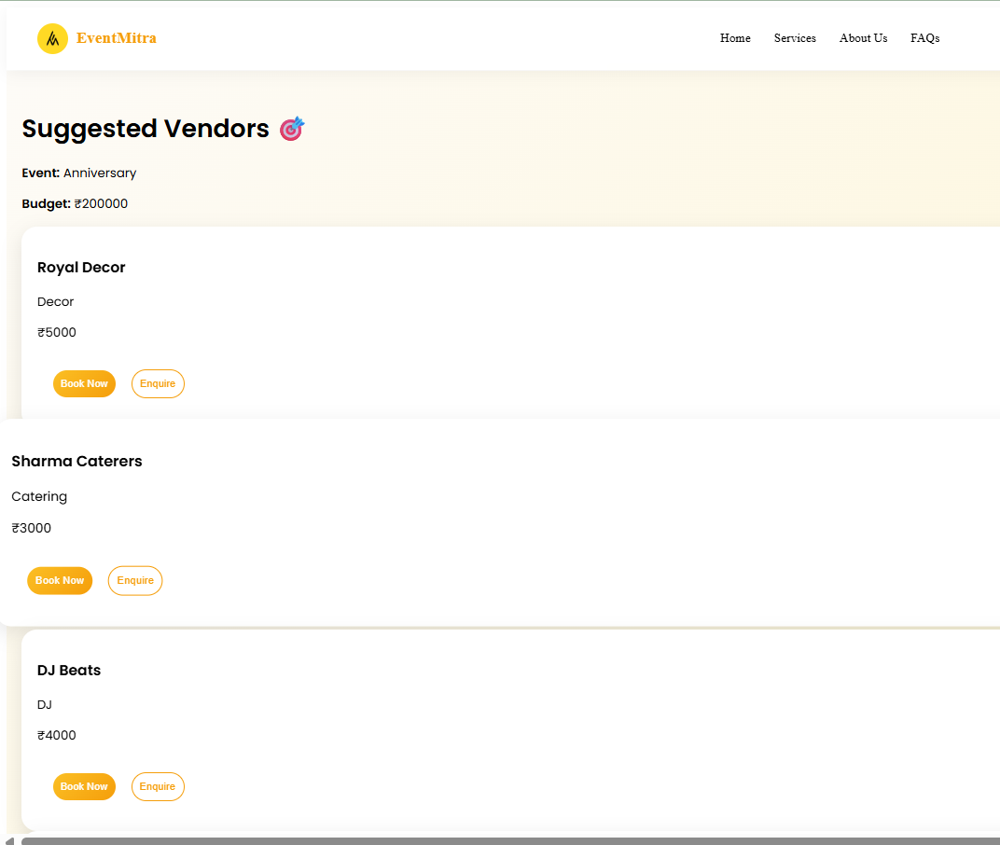

[View Full Screenshot](Screenshots/vendors.png)

### 7. Bookings
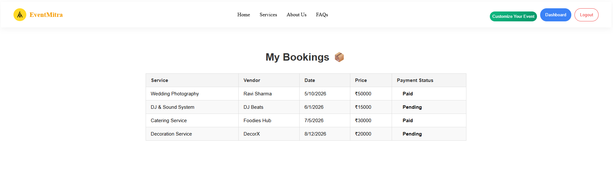

[View Full Screenshot](Screenshots/bookings.png)

### 8. Customize Event
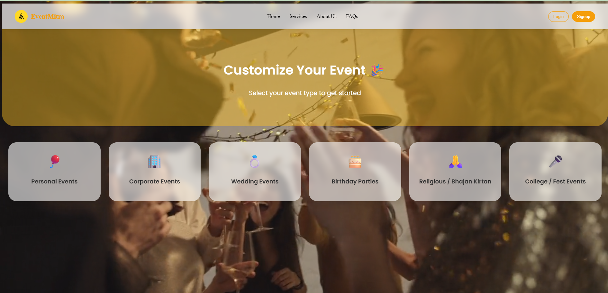

[View Full Screenshot](Screenshots/customize.png)

### 9. Generate Plan
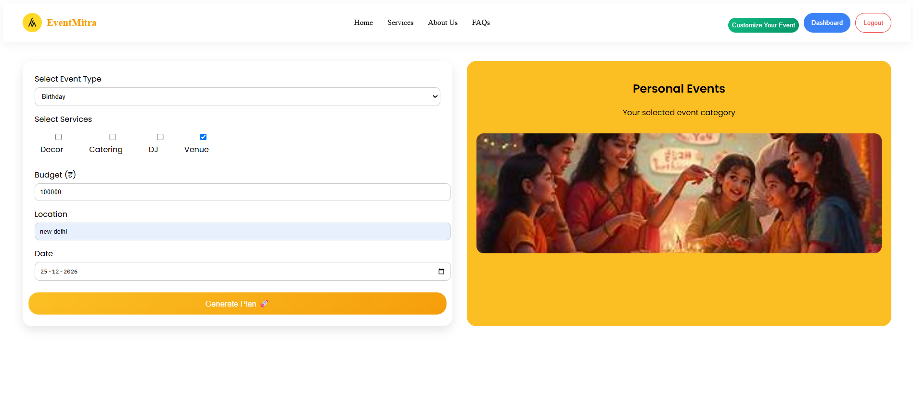

[View Full Screenshot](Screenshots/generateplan.png)

### 10. Event Plan
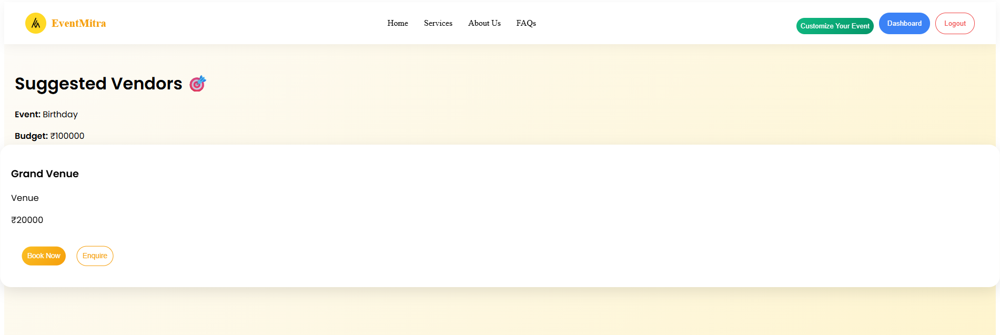

[View Full Screenshot](Screenshots/plan.png)

### 11. User Dashboard


[View Full Screenshot](Screenshots/userdashboard.png)

### 12. User Inquiries
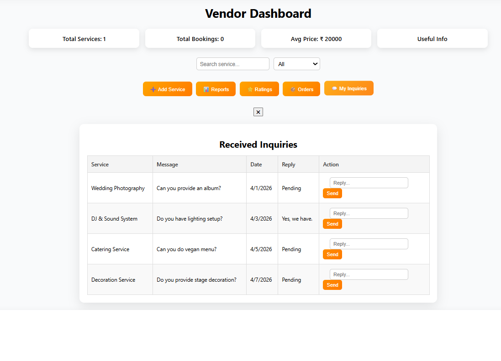

[View Full Screenshot](Screenshots/userinquiries.png)

### 13. Vendor Dashboard
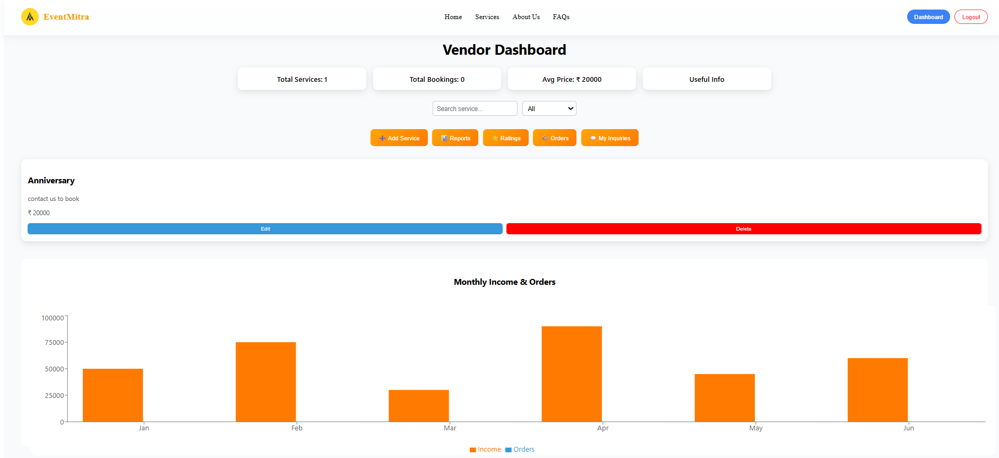

[View Full Screenshot](Screenshots/vendordashboard.png)

### 14. Inquiry Management
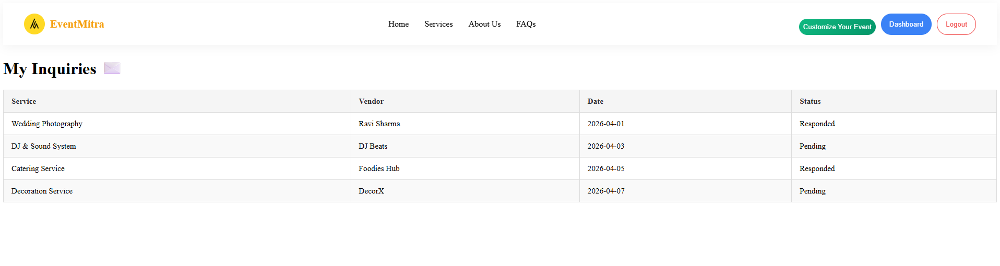

[View Full Screenshot](Screenshots/inquiry.png)

### 15. FAQ
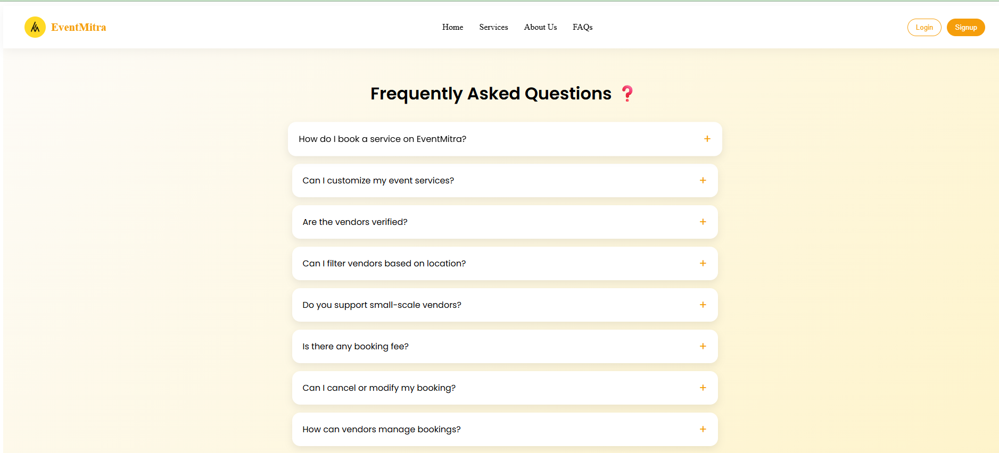

[View Full Screenshot](Screenshots/FAQ.png)

## Project Objective

The objective of EventMitra is to provide a convenient platform for event planning and service management, reducing the effort required to coordinate with multiple service providers.

## Contributors

- **Srishti Chadha** – Frontend Development and UI/UX
- **Sania** – Collaborative Development

---

**EventMitra – Plan Better. Celebrate More!**